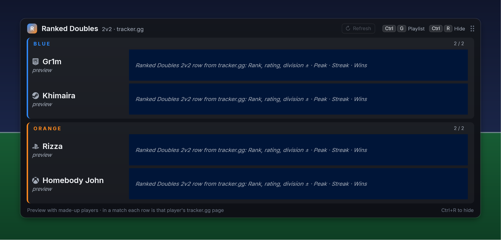
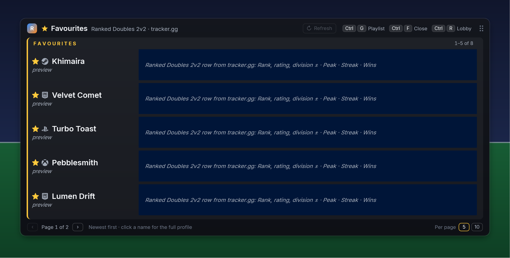

# Gr1m's RL Overlay

A small companion overlay for Rocket League. When you load into a match, a glass panel appears in the top-right
corner of the game's screen with every player's row from **tracker.gg** for the playlist you choose (2v2 by
default): rank, division, rating and how far to the next division, plus the stats you pick (**Wins**, **Streak** and
**Peak MMR** by default, and an **All-time peak** for 1v1, 2v2 and 3v3 if you tick it). Rows appear as players join,
Blue and Orange each get their own block, and the columns line up from player to player. Drag the header to move
the panel and drag a corner to resize it. The panel fades out at kickoff (or stays up, if you prefer), and clicking a
name opens that player's full tracker.gg profile. After the match the whole lobby stays available (`Ctrl+R`) so you can look up who you just
played, through freeplay and the menus, until you load into a new game with other players or close the game.
Players who quit early stay on the board too, marked *left the match*. Click the star next to a name to save that
player as a favourite; `Ctrl+F` shows everyone you saved, a page at a time. The app waits quietly in the tray,
switches on by itself when Rocket League starts and keeps itself up to date from GitHub. No account or API key is
needed.



*This is the settings Preview with made-up players. In a match each grey band is that player's row cut from their
tracker.gg page. The repository holds no screenshots of tracker.gg pages because they contain Psyonix's rank art.*

| Key | Does |
|---|---|
| `Ctrl+R` | Show / hide the lobby (works during the match too, where the next kickoff hides it again unless it is kept open, and after the match) |
| `Ctrl+G` | Next playlist: 1v1, 2v2, 3v3, Hoops, Rumble, Dropshot, Snow Day, Heatseeker, Tournaments, Casual. Every row moves at once, without reloading |
| `Ctrl+F` | Open / close your favourites (see [Favourites](#favourites)) |
| Click a name | Opens that player's tracker.gg profile in your browser |
| Click the star by a name | Saves that player as a favourite (gold star); click again to remove them |
| Drag the header | Moves the panel anywhere on its screen (the dotted grip on the right shows where to grab) |
| *Refresh* (header) | Loads every player's tracker.gg page again, for example when ranks moved since the pages loaded |
| Drag a corner | Resizes the panel, from 75 % to 150 % (blue brackets show the corners when the pointer is over them) |

The shortcuts can be changed in Settings and only work while Rocket League is the window in front. The shortcut
hints in the panel's header can be clicked too.

## How it stays safe with Easy Anti-Cheat

Rocket League uses Easy Anti-Cheat. This app is a completely separate process:

* It **never** injects into, reads memory from, hooks or opens a handle to the game process.
* Its only game data comes from Rocket League's **official Stats API**: a local socket the game itself opens on
  `127.0.0.1:49123` when it is enabled in the game's ini file. That gives the player names, platforms and teams. The
  only other contact with the game is editing that ini file, when you ask it to, with a backup first.
* It draws its own transparent, always-on-top window. That is why Rocket League must run in **Borderless** or
  **Windowed** mode: exclusive fullscreen hides every other window.

## Where the ranks come from

Each player's row is **tracker.gg's own page**, shown in a small built-in Microsoft Edge browser (WebView2), one per
player, exactly as if you opened their profile in a tab. The app then hides the rest of the page and shows only:

* the table row for the selected playlist (rank icon, rank and division, rating, the up/down to the next division),
  plus the *Peak Rating* and *Streak* cells if they are ticked, without the ⋮ menu;
* for Ranked Duel 1v1, Doubles 2v2 and Standard 3v3, the *All-Time Peak* if it is ticked: the "Best" rank and
  rating from the page's peak-rating box, labelled *All-Time Peak*. The other playlists have no such box on
  tracker.gg's main page, so the column simply isn't there for them;
* the stat tiles you ticked (*Wins*, *Goals*, *Shots*, *Assists*, *Saves*, *MVPs*), copied from the same page.

The app finds the row and tiles by their names and measures their size so every player's columns line up. It never
reads the numbers, so nothing is stored, cached or sent anywhere else.

* Pages start loading as soon as a player joins, so they are usually ready by the time you look. A shimmer marks
  rows still loading; *Refresh* in the header loads every player's page again at once (it is greyed out while there
  is nothing to reload). At the next match, pages older than a minute reload by themselves.
* Each name has its platform's mark in front of it: Steam, Epic Games, PlayStation, Xbox or Nintendo Switch. Bots
  say *BOT*.
* *No Hoops rating on tracker.gg* (for example): that player has no row for that playlist. *Not found on
  tracker.gg*: there is no profile under that name. Bots and split-screen guests have no profile.
* If a player's page has no cell that others have (a new player without a peak, say), their row leaves a gap there so
  the columns still line up.
* If a row hasn't appeared after 12 s, that line shows tracker.gg's whole page (smaller) so you can see what is
  there instead, for example a browser check. When the row loads, the line goes back to normal. The app never
  answers such checks itself.
* Steam players are found by their SteamID64. Epic, PlayStation, Xbox and Switch players are found by the name the
  game shows, which may not be the name on their tracker.gg profile.
* tracker.gg gets what a normal visit sends: the profile addresses (so the player names) and its own cookies, kept
  in `%LOCALAPPDATA%\RLOverlay\webview`. Only tracker.gg itself loads (its pages, images, fonts and data, plus
  Cloudflare's browser check): ads, video players and trackers are blocked, since they never showed anyway.

**Keeping the game smooth.** Loading a lobby used to cost frames. Now at most three pages load at once, out of
sight and at below-normal priority, without the page's ads and videos. Once a row is in, it is shown as a still
picture taken from the page, and the browser stops sending frames to the overlay. Measured on a 2v2 lobby: about a
quarter of the CPU time 0.4 needed to load it, GPU use from about 9 % to under 1 %, and about 0 % CPU once the
rows are in (0.4 kept using around half a core for as long as the lobby was up). Switching playlist or stats crops
the same pages again and takes new pictures, so it is still instant.

## Requirements

* Windows 10 (version 1809 or later) or 11, 64-bit, and Rocket League (Steam or Epic) in **Borderless** or
  **Windowed** mode.
* The Microsoft Edge WebView2 Runtime (part of Windows 11 and already installed on almost every Windows 10 PC).
* The published exe is self-contained: no .NET install needed.
* To build from source: .NET SDK 8 or newer (the projects target .NET 8).

## Install

Build the installer (and a portable copy) into `publish/`:

```bash
dotnet publish src/RLOverlay.App -c Release -p:PublishProfile=SingleFile
```

Run **`publish/Gr1msRLOverlay-Setup.exe`**. It installs for your Windows account only (no admin prompt) into
`%LOCALAPPDATA%\Programs\Gr1m's RL Overlay`, adds a Start menu shortcut and an entry in *Settings → Apps*, and
offers:

* **Start with Windows** (on by default). The app then waits in the notification area and switches on by itself
  whenever you open Rocket League.
* A desktop shortcut.
* Opening the app when setup finishes.


Running the setup again updates the installed copy (it closes the running one first), but from 0.5 on new
versions also install themselves (see [Updates](#updates)). To remove it: *Settings → Apps → Gr1m's RL Overlay →
Uninstall*. Your settings are kept unless you tick the box to delete them.

`publish/RLOverlay.exe` is the same program without installing: run it from any folder. Both files are about 70 MB
and need no .NET install. They are not code-signed, so Windows SmartScreen may warn the first time; choose
*More info → Run anyway* if you built them yourself.

## First-time setup

1. **Install it** (above). Nothing pops up apart from a short notice: the app lives in the system tray (the blue
   and orange **R**; it may be under the ^ arrow). Double-click it for Settings.
2. **Turn on the Stats API.** In Settings → *Game connection* (or the tray menu → *Enable Stats API…*) click
   **Enable Stats API…**. The app finds your Steam or Epic install, shows which ini files it will change, and after
   you click OK it copies each one to `<file>.bak-<date>-<time>` and sets `PacketSendRate=30` and `Port=49123`.
   Files that are already enabled are left alone. If the game folder needs admin rights, Windows asks once.
   **Restart Rocket League afterwards**: the game only reads the file when it starts.

   To do it by hand instead: close the game, open `<Rocket League folder>\TAGame\Config\TAStatsAPI.ini` (or
   `DefaultStatsAPI.ini` if that one doesn't exist) and make sure it contains:

   ```ini
   [TAGame.MatchStatsExporter_TA]
   PacketSendRate=30
   Port=49123
   ```

3. **Set the game to Borderless.** Rocket League → Settings → Video → *Display Mode* → **Borderless** (or Windowed).
   In exclusive fullscreen the overlay can't be drawn on top; the app tells you once if it sees that.
4. **Pick the stats** (optional). Settings → *Stats next to each rank*: Wins, Streak and Peak MMR are ticked; add
   All-time peak (1v1, 2v2 and 3v3 only), Goals, Shots, Assists, Saves or MVPs, or untick any. Every stat makes the
   rows wider.
5. *Start with Windows* (Settings → *General*) is on if you kept the setup default. Press **Save** after changes.

Settings → *Game connection* shows a green dot and "Connected to Rocket League" once the game is running with the
Stats API on.

## In a match

* Load into any match: the lobby slides in at the top right of the game's screen and fills in as players arrive.
  To keep it on another screen (a second monitor, say), pick that screen in Settings → *Position and size* →
  *Screen*. If that screen is unplugged, the lobby goes back to the game's screen until it is connected again.
* Drag the header to move it and drag any corner to make it bigger or smaller (it won't go below 75 % or above
  150 %). The panel follows the pointer once per frame your screen shows (from 0.5.1; before, it moved in jerky
  steps about 55 times a second). Where you leave it is saved straight away and used for every match after.
* `Ctrl+G` moves every row to another playlist's row on the same pages (no reload). Every match starts on your
  default playlist; tick *Follow the match's playlist* in Settings to start on the playlist you're actually playing.
* Clicking a name opens the full profile in your browser. While the browser is in front the overlay hides; alt-tab
  back to the game and it returns.
* At kickoff the lobby fades out. `Ctrl+R` brings it back mid-match; the next kickoff hides it again. To keep it on
  screen for the whole match (handy on a second screen), turn on Settings → *In a match* → *Keep the lobby open when
  the match starts*: then only `Ctrl+R` hides it, or leaving the match.
* **Players who leave** (quitters, dropped connections) stay on the board, dimmed and marked *left the match*, and
  the team header counts them (*1 / 2 · 1 left*). They go with the rest of the lobby when the next game starts; if
  they come back, the mark goes.
* **After the match** the whole lobby is kept: press `Ctrl+R` on the podium, back in the menus or in freeplay to see
  everyone you just played with and click their names. Freeplay and training don't replace it. It is replaced once
  you load into a new game with at least one other player, and cleared when you close the game.

## Favourites

Click the star next to a player's name to keep them: it turns gold and the player is saved straight away
(`favourites.json`, see [Files](#files)). Click it again to take them off. Bots and split-screen guests have no star,
since tracker.gg has no profile for them.

`Ctrl+F` (or clicking *Favourites* in the header) opens the favourites screen in place of the lobby: every saved
player's tracker.gg row for the selected playlist, newest first, **5 per page**. Use **‹ ›** at the bottom to turn the
pages and **5 / 10** to show more at once; the choice is kept, and is also in Settings → *Favourites*. `Ctrl+G`
switches the playlist
here too, a star clicked off stays on the page until you turn it (so a slip can be undone), and clicking a name opens
the full profile. `Ctrl+F` again closes it and the lobby comes back; `Ctrl+R` goes straight to the lobby. The
favourites also close at kickoff and when a new lobby loads.

A saved player who turns up under a new name keeps the new one, so their row keeps working (tracker.gg finds every
platform but Steam by name).



**Standby:** while Rocket League is closed the app does nothing but wait (tray tooltip: *standby*). When the game
starts it switches on and shows a short notice (turn that off in Settings → *General*); when the game closes it goes
back to standby and closes the pages.

## Settings and tray

Right-click the tray icon for *Show/Hide lobby*, **Settings…**, *Enable Stats API…*, *Open logs folder* and *Quit*;
double-click opens Settings. Starting the exe again while it runs also opens Settings in the running copy.

The settings window covers the game connection (Stats API status per ini file, *Enable Stats API…*, the port), the
**stats next to each rank** (Wins, Streak, Peak MMR, All-time peak, Goals, Shots, Assists, Saves, MVPs), which
playlists `Ctrl+G` cycles through and the default, the three shortcuts (click a field and press the new combination),
favourites per page,
size (75 % to 150 %, with *Reset to top right* to put the panel back in its corner), *Start with Windows* and
*Update automatically*.
**Preview** shows the lobby screen with made-up players while you adjust it, and you can drag it around and resize
it there too; nothing is kept until you press **Save**.


**Updating from an earlier version:** 0.5 adds Heatseeker to the playlists `Ctrl+G` cycles through and turns on
*Update automatically*; 0.4 and older can't update themselves, so install 0.5 once by hand (download
`Gr1msRLOverlay-Setup.exe` from the [latest release](https://github.com/Gr1m0305/RL-Rank-Viewer/releases/latest) and
run it). 0.4 moves the panel once to the new top-right spot at 85 % and turns
*Follow the match's playlist* off; drag it wherever you like afterwards. Your stats, shortcuts and playlists are
kept. From 0.2 or older: the RapidAPI, tracker.gg-key and test-data sources, the `Ctrl+T` window and the rank icon
downloads are gone; tracker.gg's rows are now the main screen, your stat choice starts once at the defaults (Wins,
Streak, Peak MMR) and old API keys are dropped the next time settings are saved.

## Updates

From 0.5, the app looks for a new release on GitHub a minute after it starts and then every 6 hours. A newer
version's setup file is downloaded in the background into `%LOCALAPPDATA%\RLOverlay\updates` and checked: its
size, GitHub's SHA-256 checksum, and that it really is this app at that version. Only this repository's release
files are accepted, and nothing about you is sent (the request carries only `RLOverlay/<version>`).

With **Update automatically** on (the default), the installed copy installs the update the next time Rocket League
is closed: setup runs without a window, replaces the app and starts the new version. It never installs in the middle
of a game. With it off, or when running a copy that isn't the installed one, the update waits in Settings →
*General*. Updates never pop up a notice: Settings → *General* shows what the updater found and last did, and has
**Check for updates** and **Install … now**. After an update the overlay starts again by itself as the new version,
in the notification area with no window open. If an update can't be installed, the old version starts again
(Settings → *General* says so; it tries again the next time it starts).

## Try it without the game

```bash
dotnet run --project src/RLOverlay.App -- --demo
```

`--demo` plays a scripted lobby of made-up players, with placeholders where tracker.gg's rows go (the published exe
takes the same flag).

## Build

```bash
dotnet build RLOverlay.sln
```

## Troubleshooting

| Problem | Try |
|---|---|
| Lobby never appears | Settings → *Game connection*: is the Stats API **On**? Restart the game after enabling it. Make sure the game is Borderless/Windowed. Check the logs (tray → *Open logs folder*). |
| "Waiting for the Stats API" while the game runs | The game was started before the ini was changed (restart it), or the port differs: leave *Stats API port* empty to read it from the ini. |
| Rows say *Needs the Microsoft Edge WebView2 Runtime* | Install the WebView2 Runtime from Microsoft, then restart the app. |
| A row shows tracker.gg's whole page | The playlist row didn't appear within 12 s: tracker.gg is slow, or shows a browser check or notice. Do what the page asks in that row; the row appears once the page has loaded. *Refresh* loads it again. |
| *Not found on tracker.gg* for someone you know is there | Console and Epic players are found by the name the game shows; if their tracker.gg profile uses another name, click their name and search on tracker.gg. |
| A stat tile is missing for one player | Their tracker.gg page doesn't show that tile (yet). The others still line up. |
| Shortcuts do nothing | They only work while Rocket League is in front. If another app already uses the combination, the log says so; pick another in Settings. |
| Lobby in the wrong place or too wide | Drag its header or a corner (in a match, or with **Preview** on in Settings). Settings → *Position and size* → *Reset to top right* puts it back. Unticking some stats makes it narrower. |
| The lobby after a match is gone | It is kept through freeplay and the menus, and replaced by the next game that has other players in it. Joining a match and leaving before anyone else arrives keeps it too. |
| An update doesn't arrive | Settings → *General* says what the updater last found (for example no connection to GitHub). It installs only while Rocket League is closed; **Install … now** does it straight away. 0.4 and older have no updater: install 0.5 by hand once. |

## Files

| Path | Contents |
|---|---|
| `%LOCALAPPDATA%\RLOverlay\settings.json` | settings |
| `%LOCALAPPDATA%\RLOverlay\favourites.json` | your favourites (platform, account id, last name seen, when added) |
| `%LOCALAPPDATA%\RLOverlay\logs\` | daily logs, 7 kept |
| `%LOCALAPPDATA%\RLOverlay\webview\` | the built-in browser's data (tracker.gg cookies and cache) |
| `%LOCALAPPDATA%\RLOverlay\updates\` | a downloaded update's setup file, until it is installed |

Earlier versions also kept `cache\`, `ranks\` and `rocket-league-api-usage.json` there; they are no longer used and
can be deleted.

**Uninstall:** *Settings → Apps → Gr1m's RL Overlay → Uninstall* (tick the box to delete settings too). For the
portable copy: turn off *Start with Windows*, quit from the tray, delete the exe and `%LOCALAPPDATA%\RLOverlay`.
Either way the ini backups stay next to the game's ini files and the Stats API stays on until you set
`PacketSendRate=0` again.

## Licence notes

Rank artwork belongs to Psyonix and is **not** included in the repository or the exe. The only rank images the app
ever shows are the ones on tracker.gg's own pages, inside the built-in browser while it runs. The screenshots in
`docs/screenshots` use made-up players and placeholders. The bundled Inter font is licensed under the SIL Open Font
License 1.1 (`licenses/Inter-OFL.txt`). The platform marks next to the names are from
[Simple Icons](https://simpleicons.org) (CC0 1.0; Xbox from release 7.0.0, as later releases no longer include it).
They are trademarks of Valve, Epic Games, Sony Interactive Entertainment, Microsoft and Nintendo, used only to show
which platform a player is on.
