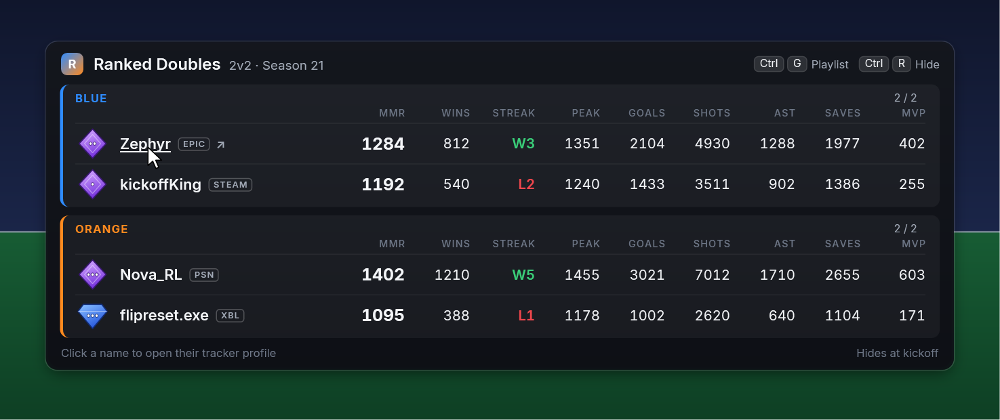
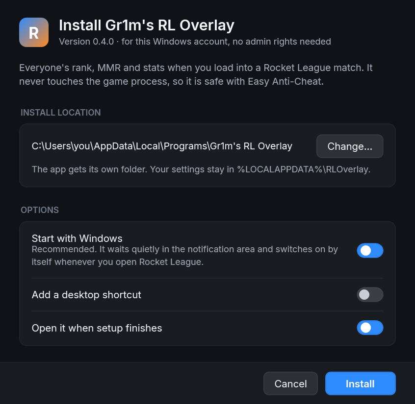
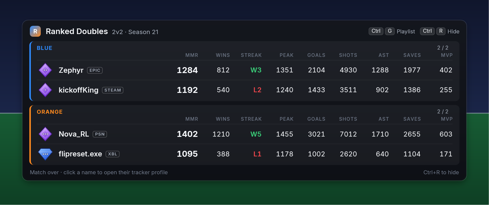
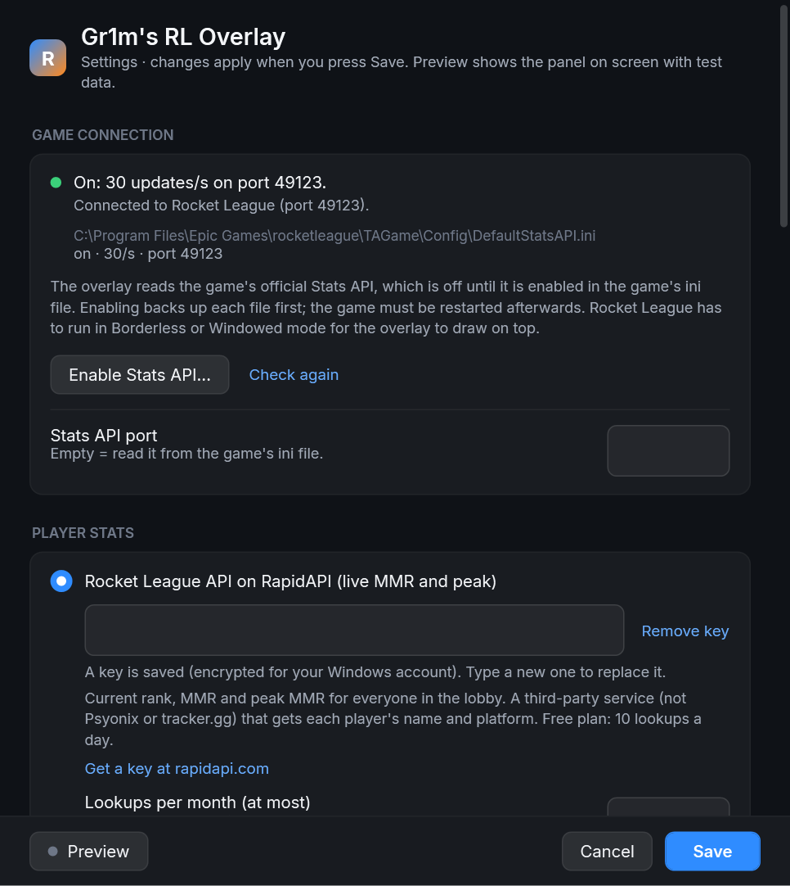

# Gr1m's RL Overlay

A small companion overlay for Rocket League. When you load into a match, a compact glass panel appears just below
the scoreboard with every player's rank icon, MMR and stats for the playlist you choose (2v2 by default). Rows fill
in live as players join, the panel fades out at kickoff, and clicking a name opens that player's tracker profile.
After the match the lobby stays available (`Ctrl+R`) so you can look up who you just played, until you load into the
next match or close the game. The app waits quietly in the tray and switches on by itself when Rocket League starts.



*Screenshots use the app's built-in placeholder icons so the repository holds no Psyonix artwork; the running app
shows the official in-game rank icons.*

| Key | Does |
|---|---|
| `Ctrl+R` | Show / hide the panel (works during the match too, where the next kickoff hides it again, and after the match) |
| `Ctrl+G` | Next playlist: 1v1, 2v2, 3v3, Hoops, Rumble, Dropshot, Snow Day, Tournaments, Casual. The strip shows for 1.5 s |
| Click a name | Opens that player's tracker profile in your browser |

Both shortcuts can be changed in Settings and only work while Rocket League is the window in front.

## How it stays safe with Easy Anti-Cheat

Rocket League uses Easy Anti-Cheat. This app is a completely separate process:

* It **never** injects into, reads memory from, hooks or opens a handle to the game process.
* Its only game data comes from Rocket League's **official Stats API**: a local socket the game itself opens on
  `127.0.0.1:49123` when it is enabled in the game's ini file. The only other contact with the game is editing that
  ini file, when you ask it to, with a backup first.
* It draws its own transparent, always-on-top window. That is why Rocket League must run in **Borderless** or
  **Windowed** mode: exclusive fullscreen hides every other window.

## Where player ranks come from: read this

Psyonix has no public rank API and Tracker Network doesn't give out Rocket League access, so live ranks come from a
third-party service you subscribe to yourself. Settings → *Player stats* offers three sources:

* **Rocket League API on RapidAPI** (the default, `RocketLeagueApiProvider`): every player's current rank, division,
  MMR and **peak MMR** in each playlist, looked up by platform and name (Steam: SteamID64 first, then the name). It is
  run by an independent developer (TonyKun7), not by Psyonix or Tracker Network, and doesn't say where its data
  comes from. It receives the name and platform of every player the app looks up. To set it up:
  1. Sign in at [rapidapi.com](https://rapidapi.com/TonyKun7/api/rocket-league10/pricing) and subscribe to a plan.
     *Basic* is free with 10 lookups a day (about two 2v2 lobbies); *Pro* is $9.99 a month for 2,000 lookups, then
     $0.01 each (prices when this was written).
  2. Copy your RapidAPI key (the `X-RapidAPI-Key` value on the API's page) into Settings → *Player stats* and press
     **Save**. It is stored encrypted for your Windows account.

  Each new player in a lobby, you included, costs one lookup (a Steam player whose ID isn't found costs two).
  Players you meet again within *Keep looked-up players for* (10 minutes by default) cost nothing. *Lookups per
  month* (2,000 by default) stops lookups before a paid plan starts charging overage; 0 turns the cap off.
* **tracker.gg API** (`TrackerGgProvider`) with your own Tracker Network key. Their developer portal is down and
  Rocket League isn't offered to public keys, so this most likely shows *No data*; it stays in case that changes.
  The app never scrapes the tracker.gg website.
* **Test data** (`MockStatsProvider`): made-up numbers, no account. The `--demo` flag and the *Preview* button use
  it too.

Names, platforms and teams always come from the game, and clicking a name opens the player's tracker.gg profile.

## Requirements

* Windows 10 or 11 (64-bit) and Rocket League (Steam or Epic) in **Borderless** or **Windowed** mode.
* The published exe is self-contained: no .NET install needed.
* To build from source: .NET SDK 8 or newer (the projects target .NET 8).

## Install

Build the installer (and a portable copy) into `publish/`:

```bash
dotnet publish src/RLOverlay.App -c Release -p:PublishProfile=SingleFile
```

Run **`publish/Gr1msRLOverlay-Setup.exe`**. It installs for your Windows account only (no admin prompt) into
`%LOCALAPPDATA%\Programs\Gr1m's RL Overlay`, adds a Start menu shortcut and an entry in *Settings → Apps*, and
offers:

* **Start with Windows** (on by default). The app then waits in the notification area and switches on by itself
  whenever you open Rocket League.
* A desktop shortcut.
* Opening the app when setup finishes.



Running the setup again updates the installed copy (it closes the running one first). To remove it: *Settings →
Apps → Gr1m's RL Overlay → Uninstall*. Your settings are kept unless you tick the box to delete them.

`publish/RLOverlay.exe` is the same program without installing: run it from any folder. Both files are about 68 MB
and need no .NET install. They are not code-signed, so Windows SmartScreen may warn the first time; choose
*More info → Run anyway* if you built them yourself.

## First-time setup

1. **Install it** (above). Nothing pops up apart from a short notice: the app lives in the system tray (the blue
   and orange **R**; it may be under the ^ arrow). Double-click it for Settings.
2. **Turn on the Stats API.** In Settings → *Game connection* (or the tray menu → *Enable Stats API…*) click
   **Enable Stats API…**. The app finds your Steam or Epic install, shows which ini files it will change, and after
   you click OK it copies each one to `<file>.bak-<date>-<time>` and sets `PacketSendRate=30` and `Port=49123`.
   Files that are already enabled are left alone. If the game folder needs admin rights, Windows asks once.
   **Restart Rocket League afterwards**: the game only reads the file when it starts.

   To do it by hand instead: close the game, open `<Rocket League folder>\TAGame\Config\TAStatsAPI.ini` (or
   `DefaultStatsAPI.ini` if that one doesn't exist) and make sure it contains:

   ```ini
   [TAGame.MatchStatsExporter_TA]
   PacketSendRate=30
   Port=49123
   ```

3. **Set the game to Borderless.** Rocket League → Settings → Video → *Display Mode* → **Borderless** (or Windowed).
   In exclusive fullscreen the overlay can't be drawn on top; the app tells you once if it sees that.
4. **Choose the stats source.** Settings → *Player stats*: paste your RapidAPI key for the Rocket League API (see
   "Where player ranks come from" above), or pick *Test data* to see made-up numbers.
5. *Start with Windows* (Settings → *General*) is on if you kept the setup default. Press **Save** after changes.

Settings → *Game connection* shows a green dot and "Connected to Rocket League" once the game is running with the
Stats API on.

## In a match

* Load into any match: the panel slides in below the scoreboard and fills in row by row as players arrive (a
  shimmer marks rows still loading).
* `Ctrl+G` switches every row to another playlist's rank and MMR (no new lookups). Casual shows casual MMR with the
  unranked icon. *Follow the match's playlist* (on by default) starts on the playlist you're actually playing.
* Clicking a name opens the profile in your browser. While the browser is in front the overlay hides; alt-tab back
  to the game and it returns.
* At kickoff the panel fades out. `Ctrl+R` brings it back mid-match; the next kickoff hides it again.
* **After the match** the lobby is kept: press `Ctrl+R` on the podium or back in the menus to see everyone you just
  played with and click their names. It is replaced when you load into the next match and cleared when you close
  the game.



**Standby:** while Rocket League is closed the app does nothing but wait (tray tooltip: *standby*). When the game
starts it switches on and shows a short notice (turn that off in Settings → *General*); when the game closes it goes
back to standby.

## Settings and tray

Right-click the tray icon for *Show/Hide panel*, **Settings…**, *Enable Stats API…*, *Open logs folder* and *Quit*;
double-click opens Settings. Starting the exe again while it runs also opens Settings in the running copy.

The settings window covers the game connection (Stats API status per ini file, *Enable Stats API…*, the port), the
stats source, API keys and monthly lookup cap, which playlists `Ctrl+G` cycles through and the default, which columns to show, the two
shortcuts (click a field and press the new combination), position and size, rank icon downloads, and *Start with
Windows*. **Preview** shows the panel with a sample lobby while you adjust it; nothing is kept until you press
**Save**.



## Try it without the game

```bash
dotnet run --project src/RLOverlay.App -- --demo
```

`--demo` plays a scripted lobby with test data (the published exe takes the same flag). To test the real connection
path, run the fake Stats API server in one terminal and the overlay in another:

```bash
dotnet run --project tools/FakeStatsServer -- tests/fixtures/scenarios/lobby_2v2.json --port 49200
```

```bash
dotnet run --project src/RLOverlay.App -- --provider mock --port 49200 --always-connect --ungated-hotkeys --dry-run-links
```

(`--always-connect` skips standby, since Rocket League itself isn't running.)

Players join over 5 s, the lobby waits about 30 s (try `Ctrl+G`, `Ctrl+R`), kickoff hides the panel at 33 s and the
match is destroyed at 66 s (the lobby stays: `Ctrl+R` shows it). Type `kickoff`, `countdown`, `created`, `destroyed` or `quit` in the server window to
send those events right away. `lobby_3v3.json` is a 3v3 lobby. All launch flags are listed in
[docs/ARCHITECTURE.md](docs/ARCHITECTURE.md#launch-flags).

## Build and test

```bash
dotnet build RLOverlay.sln
```

```bash
dotnet test RLOverlay.sln
```

## Troubleshooting

| Problem | Try |
|---|---|
| Panel never appears | Settings → *Game connection*: is the Stats API **On**? Restart the game after enabling it. Make sure the game is Borderless/Windowed. Check the logs (tray → *Open logs folder*). |
| "Waiting for the Stats API" while the game runs | The game was started before the ini was changed (restart it), or the port differs: leave *Stats API port* empty to read it from the ini. |
| Rows say *No data* | The stats provider has nothing for that player (see "Where player ranks come from"). Use *Test data* to check the overlay itself. |
| *No data* for everyone with the Rocket League API | Check the log (tray → *Open logs folder*): 401/403 or "not subscribed" = wrong key or no plan on RapidAPI; "allowance is used up" = your plan's requests for the day or month are spent; "Monthly lookup limit reached" = the app's own cap (Settings → *Lookups per month*). |
| Shortcuts do nothing | They only work while Rocket League is in front. If another app already uses the combination, the log says so; pick another in Settings. |
| Panel in the wrong place | Settings → *Position and size*, with **Preview** on to see it move. |
| Placeholder icons instead of the real ones | The first start downloads them; check the internet connection, or Settings → *Rank icons* → *Download again*. |

## Files

| Path | Contents |
|---|---|
| `%LOCALAPPDATA%\RLOverlay\settings.json` | settings (API keys encrypted with Windows DPAPI for your account) |
| `%LOCALAPPDATA%\RLOverlay\logs\` | daily logs, 7 kept |
| `%LOCALAPPDATA%\RLOverlay\cache\` | looked-up players and the downloaded rank icons |
| `%LOCALAPPDATA%\RLOverlay\rocket-league-api-usage.json` | Rocket League API lookups made this month (for the cap) |
| `%LOCALAPPDATA%\RLOverlay\ranks\` | your own rank icons, if you want to replace the downloaded ones |

**Uninstall:** *Settings → Apps → Gr1m's RL Overlay → Uninstall* (tick the box to delete settings too). For the
portable copy: turn off *Start with Windows*, quit from the tray, delete the exe and `%LOCALAPPDATA%\RLOverlay`.
Either way the ini backups stay next to the game's ini files and the Stats API stays on until you set
`PacketSendRate=0` again.

## Docs

* [docs/STATS_API_NOTES.md](docs/STATS_API_NOTES.md): what the Stats API sends and how the app reads it
* [docs/ARCHITECTURE.md](docs/ARCHITECTURE.md): components, data flow, match lifecycle state machine, launch flags
* [PROGRESS.md](PROGRESS.md): build log, decisions and open questions

## Licence notes

Rank artwork belongs to Psyonix and is **not** included in the repository or the exe. On first start the app
downloads the official in-game rank icons once (from Tracker Network's CDN, the images tracker.gg shows) into
`%LOCALAPPDATA%\RLOverlay\cache\ranks\`. Until then, or if downloads are turned off, it draws simple built-in
placeholders, which is also what the screenshots in `docs/screenshots` show. Your own icons win over the download
(see [assets/ranks/README.md](assets/ranks/README.md)). The bundled Inter font is licensed under the SIL Open Font
License 1.1 (`licenses/Inter-OFL.txt`).
